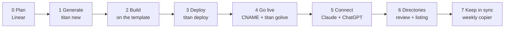

# New Titan project checklist

From an idea to an app that is live on `<slug>.ultraniche.ai`, connects
from Claude and ChatGPT, and is ready for both app directories. Written
from the week of 11–15 October 2026, when Tally, Gondola and Traintrackr
went through it the long way. Tick it top to bottom; every step says the
command or the setting.



| Phase | Who | Where it happens | Done when |
| --- | --- | --- | --- |
| 0 Plan | Claude, Hugo signs off | Linear, Titan team | The project and first issue exist, scope agreed |
| 1 Generate | Hugo's machine | `titan new` | Private repo on GitHub, app in `apps.json` |
| 2 Build | Claude | the app's repo | `uv run tox` green, front page follows DESIGN.md §12 |
| 3 Deploy | Hugo's machine | `titan deploy`, one Render click | `/healthz` green on `onrender.com` |
| 4 Go live | Hugo | Squarespace DNS, `titan golive` | Site on its domain, fivebar counting |
| 5 Connect | Hugo | claude.ai, chatgpt.com | Both clients sign in and call a tool |
| 6 Directories | Hugo | Anthropic and OpenAI submission forms | Reviewer can sign in with no email |
| 7 Keep in sync | the weekly routine | template + app repos | One update PR a week, merged |

---

## The app sheet: fill this in first

Every value a new app needs, in one place. Fill in the right-hand column
in the Linear project's description before phase 1; copier, titan, the
pages and both directory forms all draw from it. Tally is the worked
example.

**Identity**

| Value | Tally | Goes into | Set by |
| --- | --- | --- | --- |
| Name | Tally | header, manifest, emails, consent page, directory listings | copier `project_name` |
| Slug | `tally` | repo, Render services, database and role, subdomain, Resend key, cache prefix | copier `project_slug` |
| One-line description | Interval workouts built from a library of exercises, run hands-free on a phone | manifest, meta description, placeholder share card | copier `description` |
| Promise (the H1) and lede | Timed and tallied. Say hi to your new AI trainer. | front page, share card | `public/home.html` |
| Brand colour | `#1F3FD8` | icons, `theme-color`, launch screen, share card | copier `theme_colour` |
| Icon | `static/icons/icon.svg` | home screen, favicon, **512×512 PNG for the directories** | `bin/make-icons` draws a placeholder; replace it |
| Share card | `static/img/share-card.png`, 1200×630 | link unfurls | `bin/make-share-card` placeholder; replace it |
| Copyright holder | Ultraniche (Tally still has the default, Hugo Rodger-Brown) | footer © line | copier `copyright_holder` |
| Linear project and key | Tally, `RAS-` | issues, PR titles | Phase 0 |

**Addresses**

| Value | Pattern | Goes into | Set by |
| --- | --- | --- | --- |
| Site URL | `https://<slug>.ultraniche.ai` | `SITE_URL`, passkey RP ID, directory "website" | `titan golive` |
| MCP URL | `https://<slug>.ultraniche.ai/mcp` | front page, Help, connector set-up, directory "server URL" | derived from `SITE_URL` |
| Help, Terms, Privacy URLs | `/help/`, `/terms/`, `/privacy/` | footer, directory forms | the template |
| Sender | `<Name> <<slug>@mail.ultraniche.ai>` | `DEFAULT_FROM_EMAIL` (send-only domain) | `titan deploy` |
| **Contact / support email** | an address that **receives** mail | Help's "Contact us", Privacy's "Contact", Terms, directory "support contact" | by hand: the template ships `support@example.com` and *"Placeholder: add a contact address"* |
| Reviewer sign-in | `reviewer@<slug>.ultraniche.ai` + its code | directory forms only | admin, `ReviewerAccount` |
| Developer / publisher | Ultraniche | directory forms | by hand |

`mail.ultraniche.ai` only sends, so the contact address needs a mailbox
or forward elsewhere. Traintrackr uses `support@traintrackr.live`; Tally
and Gondola have no contact address on any page yet.

**Decisions**

| Decision | Default | Where |
| --- | --- | --- |
| Serve `/mcp`? | yes | copier `include_mcp` |
| Who may connect | staff only; widen to active accounts for launch | `apps/mcp/policy.py`, in a PR that says so |
| Keep email addresses? | no: a key and a masked address | `ACCOUNTS_KEEP_EMAIL` in settings; can be switched later, accounts convert at next sign-in |
| Scheduled jobs | the daily purge | `render.yaml` (leave the cron out if there are none) |
| Render region | frankfurt | copier `render_region` |
| What the tools withhold | nothing | app's CLAUDE.md, tool descriptions, privacy notice |

**For the directory listings** (gather once, used by both forms)

| Value | Source |
| --- | --- |
| Short description | the one-line description |
| Long description | the front page's lede and "how it works" tiles |
| Three to five example prompts | the front page's "Try asking" list |
| Screenshots | the live product (the front page's demo, the board in Claude) |
| Category | pick per directory |
| Privacy, terms, support URLs and contact email | the addresses above |
| Test account | the reviewer sign-in above |
| ChatGPT domain token | `OPENAI_APPS_CHALLENGE` on the app's group |

The two forms change; check each field against the form on the day.

## Before the first app: one-off set-up

Already done for the apps so far; check it once on a new machine.

- [ ] `uv tool install "git+https://github.com/hugorodgerbrown/django-titan-template#subdirectory=titan"` (and `uv tool upgrade titan` before each new app)
- [ ] `gh` signed in, `uvx` on the path, and the 1Password CLI `op`
- [ ] 1Password item **Titan** with fields `RENDER_API_KEY`, `RESEND_API_KEY` (**full-access**: it makes each app's sending key), `TITAN_DB_ADMIN_URL` (shared-db's *External* URL) and `FIVEBAR_API_KEY` (a token with **add sites** switched on in fivebar's Settings)
- [ ] Run titan from a machine on shared-db's IP allowlist. A cloud session can't reach it, so titan's database step only works from your own addresses
- [ ] `mail.ultraniche.ai` verified in Resend (it is; every app sends from `<slug>@mail.ultraniche.ai`)

## 0 · Plan

- [ ] Fill in [the app sheet](#the-app-sheet-fill-this-in-first) in the project's description
- [ ] Create the app's **Linear project** in the Titan team (`RAS-`), named after the app ([why](template/docs/decisions/every-change-starts-as-a-linear-issue.md))
- [ ] File the first issue with the scope: what changes, what doesn't, how we'll know it's done, the decision behind it
- [ ] Agree the scope on the issue before any code. One issue per PR; Dependabot is the only exception
- [ ] Write the Linear docs with the skills the template ships: `titan-research-docs` (prior art, competitors, app store reviews), `titan-user-testing-script`, `titan-blog-post`
- [ ] Settle the product decisions that shape privacy early, and write them in the app's CLAUDE.md. Gondola's "MCP tools never name a friend, counts only" changed its tools, help and privacy notice in one go; deciding it later meant three PRs

## 1 · Generate

```sh
titan new <slug> --name "<Name>" --description "<one line>"
```

- [ ] `titan new` only asks for the name and description; copier takes the template's defaults for everything else. Set the rest straight after, in the new checkout, then commit and push:

  ```sh
  copier update --trust --defaults \
    --data copyright_holder=Ultraniche \
    --data theme_colour='#1F3FD8' \
    --data include_mcp=true --data render_region=frankfurt
  ```
- [ ] Check the new repo is private on GitHub and the app is in [apps.json](apps.json) at stage `new`
- [ ] Add the repo to the Claude project and to the weekly copier routine's repositories. The routine can only reach repos in its settings, so an app in `apps.json` but not there is silently skipped
- [ ] Add the repo to the Titan Linear project's links

## 2 · Build on the template

Rules every app carries in its generated `CLAUDE.md` and `DESIGN.md`. The
ones that bit us:

- [ ] **Every branch starts with `copier update --trust`** as its own first commit, then `uv run tox`. Skip the commit if nothing changed; never an empty commit
- [ ] **Accounts keep a key, not the address.** Leave `ACCOUNTS_KEEP_EMAIL` off unless the app must email people after sign-in (digests, alerts). It can be switched later: each account converts at its next sign-in. What can't change is `ACCOUNTS_EMAIL_KEY` (phase 3)
- [ ] **Front page in the shared shape** (DESIGN.md §12): the promise as H1, one primary action named for the first job, the product drawn live with demo data (not a screenshot), the AI-chat section with the `/mcp` address and a link to Help's *Use it from Claude or ChatGPT*, the closing action, the footer with ©
- [ ] **Share card:** replace the placeholder `static/img/share-card.png` with a 1200×630 card, the promise beside the product. No `og:url` tag (a sign-in link's address is its token)
- [ ] **Header:** the mark goes home; one link on the right, *Sign in* or *Open the app*. No passkey prompt until *Sign in with a passkey* is pressed
- [ ] **Design page** at `/app/design/` shows every new component and state; tokens only (`tests/test_design.py` fails a raw colour or an undeclared `var()`)
- [ ] **Onboarding tour:** write `docs/onboarding-tour.md` and agree it before building; runs on a private demo copy, measured in fivebar
- [ ] **Links in templates use `` or `format_html`**, never `href="{{ var }}"`: semgrep's `var-in-href` fails `tox -e sast`
- [ ] **New offline static files** go in `apps/pwa/conf.py: PRECACHE_STATIC`; watch the byte budget
- [ ] **Replace every placeholder** on Help, Terms and Privacy: the contact address (`support@example.com`, *"Placeholder: add a contact address"*) and the *Placeholder* notices. Terms reviewed before launch
- [ ] **Docs move with the code in the same PR.** Privacy, terms, help, README and `docs/accounts.md` say what this branch stores and sends (Traintrackr's terms once said the address was never stored while the code stored it)
- [ ] **MCP tool descriptions** say what is withheld and why, so the assistant passes it on
- [ ] `uv run tox` green before every PR; `PR title RAS-NN: …`, body starts `Closes RAS-NN`
- [ ] Resolve each review thread on GitHub once it's fixed

## 3 · Deploy

```sh
titan deploy <slug>
```

titan shows the plan and asks before changing anything. It makes,
before the first deploy:

| Made by titan | Where |
| --- | --- |
| Role + database `<slug>` | shared-db |
| Sending-only Resend key, locked to `mail.ultraniche.ai` | Resend |
| Shared group `titan`: `DJANGO_DEBUG=0`, `PYTHON_VERSION`, `DJANGO_ALLOWED_HOSTS=.ultraniche.ai`, `DJANGO_CSRF_TRUSTED_ORIGINS`, SMTP host/port/user/TLS | Render env group |
| App group `<slug>`: `DATABASE_URL`, `DJANGO_SECRET_KEY`, **`ACCOUNTS_EMAIL_KEY`**, `EMAIL_HOST_PASSWORD`, `DEFAULT_FROM_EMAIL=<Name> <<slug>@mail.ultraniche.ai>` | Render env group |

- [ ] Click **Deploy Blueprint** when titan opens the link. It's the one step Render has no API for
- [ ] **Copy `ACCOUNTS_EMAIL_KEY` into the 1Password Titan item** (a field per app). Changing or losing it strands every account, and Render is the only other copy
- [ ] Set the app's own secrets on its group (Traintrackr: `DARWIN_API_KEY`, `NR_USERNAME`, `NR_PASSWORD`)
- [ ] Check both services link both groups, the web service and `<slug>-purge`. The cron job needs `DATABASE_URL` too
- [ ] `/healthz` green on the `onrender.com` address (titan checks it)
- [ ] Sign in once on `onrender.com` and check the email arrives fast: the page should answer at once, the email follow

## 4 · Go live

```sh
titan golive <slug>
```

- [ ] Add the CNAME titan prints in **Squarespace Domains** (`<slug>` → the service's `onrender.com` name). Squarespace has no DNS API, so this is the one by-hand step
- [ ] Let titan wait for Render to verify the domain and issue the certificate
- [ ] titan sets `SITE_URL=https://<slug>.ultraniche.ai` and `FIVEBAR_DOMAIN`, adds the site to fivebar, deploys, and moves the app to `live` in `apps.json`
- [ ] **Passkeys:** add one on the real domain. If it fails, `SITE_URL` is wrong (the RP ID must be the domain people use)
- [ ] **fivebar:** sign up once on the live domain; *Sign up* should appear under Goals
- [ ] Unfurl the front page in Slack or iMessage and check the share card
- [ ] An app on its own domain (Traintrackr on `traintrackr.live`) does this step by hand: domain on the service, add it to `DJANGO_ALLOWED_HOSTS`, set `SITE_URL` and `FIVEBAR_DOMAIN` in the app's group
- [ ] Add the app to the [ultraniche.ai homepage](https://github.com/hugorodgerbrown/ultraniche-homepage): one edit to its `apps.json`

## 5 · Connect from Claude and ChatGPT

Skip if the app has no `/mcp`.

- [ ] **Decide who may connect.** The template defaults to staff only. A public launch widens `MCP_AUTH["CAN_CONNECT"]` (`apps/mcp/policy.py`) to active accounts, in a PR that says so (invariant 7)
- [ ] mcp-auth is at the template's pin (computed, so `copier update` moves it). v0.1.2 lets Claude connect; v0.1.3 lets ChatGPT connect
- [ ] **Claude:** Customize → Connectors → Add custom connector, `https://<slug>.ultraniche.ai/mcp`, OAuth fields empty. Reaches the consent page, connects, and a tool answers
- [ ] **ChatGPT:** follow Help's *Use it from Claude or ChatGPT* steps (developer mode, then Apps → Create, OAuth). Reaches consent and a tool answers
- [ ] Consent page says *Signed in as* the right account, with *Use another account*
- [ ] `/oauth/connected/` lists both apps, and *Disconnect* works

## 6 · Directory submission (Anthropic and OpenAI)

What both reviews asked for, and where it lives in the template:

| Reviewers need | Template provides | To do |
| --- | --- | --- |
| A test account with no email, SMS or MFA | `ReviewerAccount` in the admin: an address and a fixed six-digit code ([docs/accounts.md](template/docs/accounts.md#reviewer-accounts)) | Add `reviewer@<slug>.ultraniche.ai`, read the code, give both to the form |
| Domain ownership for ChatGPT's directory | `/.well-known/openai-apps-challenge` serves `OPENAI_APPS_CHALLENGE` | Set the token on the app's group, deploy, then verify |
| A support contact | Help's "Contact us" and Privacy's "Contact" (placeholders) | A real address that receives mail |
| Privacy policy, terms, help | `/privacy/`, `/terms/`, `/help/`, and the `privacy_policy`, `terms_of_service`, `help` MCP tools | Check they say what *this* app stores, uses and sends |
| An icon | `static/icons/` | Upload a 512×512 PNG |
| Clear tool behaviour | the tools' descriptions | Read each one as a reviewer would; say what is withheld |

- [ ] Reviewer account added; sign in with it yourself first, in a private window, through Claude's connector
- [ ] `OPENAI_APPS_CHALLENGE` set; `curl https://<slug>.ultraniche.ai/.well-known/openai-apps-challenge` returns the bare token
- [ ] Submit to Claude's connector directory and to ChatGPT's app directory
- [ ] Optional: list in the [MCP Registry](https://registry.modelcontextprotocol.io) (Traintrackr is `live.traintrackr/traintracker`)
- [ ] Once listed, lead Help's Claude steps with the directory link and keep *add by address* as the fallback
- [ ] After the review: **Give the selected accounts a new code**, or delete the reviewer account

## 7 · Keep in sync

- [ ] `apps.json` shows the app at stage `live` with `updates: true`
- [ ] The weekly routine (Mondays 07:56 UK) opens one `chore/copier-update` PR per app that's behind; review and merge it like any PR
- [ ] Set `updates: false` in a PR to pause one app during a rewrite

---

## Snags we hit, so you can spot them

| Symptom | Cause | Now |
| --- | --- | --- |
| 500 on `POST /sign-in/`, `SMTPDataError 550 … not authorized to send emails from ultraniche.ai` | From-address on `@ultraniche.ai`; the key is locked to `mail.ultraniche.ai` | titan sets `DEFAULT_FROM_EMAIL` on the mail domain |
| Sign-in page slow, or a 500 when Resend is slow | Email sent inside the request (`ImmediateBackend`) | `ThreadBackend`, capped at 8 threads (template #21, #29) |
| *"That didn't work"* on adding a passkey | No `SITE_URL`, so the RP ID was the `onrender.com` name | golive sets it (Tally also answers 409 `wrong_host`; template pending) |
| Cron job fails: `no such table: core_idempotencyrecord` | `<slug>-purge` had no `DATABASE_URL`, fell back to SQLite | Env groups link both services (Tally also refuses to start without it; template pending) |
| Claude: *"Invalid client_id parameter value"* | Claude's client metadata lists the JWT-bearer grant | mcp-auth v0.1.2 |
| ChatGPT: *"Invalid client_id parameter value"* | ChatGPT's metadata declares `private_key_jwt` | mcp-auth v0.1.3 verifies its signed assertions |
| Apps stuck on an old mcp-auth after `copier update` | The version was an answered question, replayed forever | Computed, not asked (template #32) |
| Help's ChatGPT steps wrong | OpenAI moved developer mode | Shared steps in the template's Help; fix copies on update |
| A passkey prompt nobody asked for on the sign-in page | Conditional mediation on load | Passkey only on its button (template #26) |
| `tox -e sast` fails on a link | `href="{{ var }}"` (semgrep `var-in-href`) | `` or `format_html` |
| Sign-in token in the share tags | `og:url` copied the address | No `og:url`, with a test |
| A style silently missing | `var(--undeclared)` drops the declaration | Design check fails an undeclared token |
| Terms contradicted the code | Docs updated in a follow-up, not the PR | Docs move in the same PR |
| Consent page showed a 64-character hex key | Username is the email's key | mcp-auth v0.1.5 `ACCOUNT_NAME`, masked address (Traintrackr; template pending) |
| Admin search's email in the access log | gunicorn logs query strings | Path-only log format (Traintrackr; template pending) |
| `titan` couldn't check shared-db roles | shared-db IP allowlist | Run titan from your own machine |
| An app listed as `new` though live | Register written before go-live was checked | Run `titan golive <slug>` again; each step does only what is missing |

## Still open in the template

Carry these by hand until they land, then delete the line.

- [ ] A copier question (or `apps/public/conf.py` setting) for the **contact email**, used by Help, Privacy and Terms, instead of `support@example.com`; and give Tally and Gondola one
- [ ] `titan new` flags for the other copier answers (copyright holder, colour, MCP, region), so the `copier update --data` step in phase 1 goes away
- [ ] Pin mcp-auth **v0.1.5** and point `MCP_AUTH["ACCOUNT_NAME"]` at the masked address, so the consent page doesn't show the key ([RAS-49](https://linear.app/hugorodgerbrown/issue/RAS-49))
- [ ] gunicorn `--access-logformat` without the query string, as Traintrackr's `render.yaml` has
- [ ] The "docs move with the code in the same PR" rule in the template's CLAUDE.md (only Traintrackr has it)
- [ ] Tally's two guards: stop on Render when `DATABASE_URL` is missing, and answer 409 `wrong_host` when the host isn't the passkey RP ID
- [ ] Self-serve account deletion ([RAS-36](https://linear.app/hugorodgerbrown/issue/RAS-36)); directories expect a way to leave
- [ ] Tally and Gondola still to take the RAS-48 accounts change ([RAS-50](https://linear.app/hugorodgerbrown/issue/RAS-50), [RAS-51](https://linear.app/hugorodgerbrown/issue/RAS-51))
